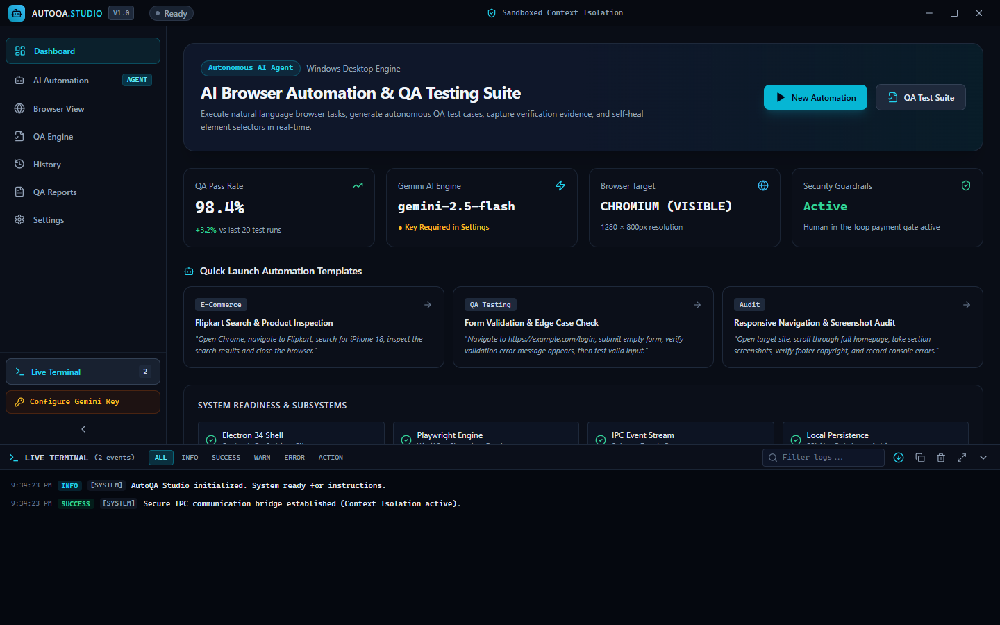
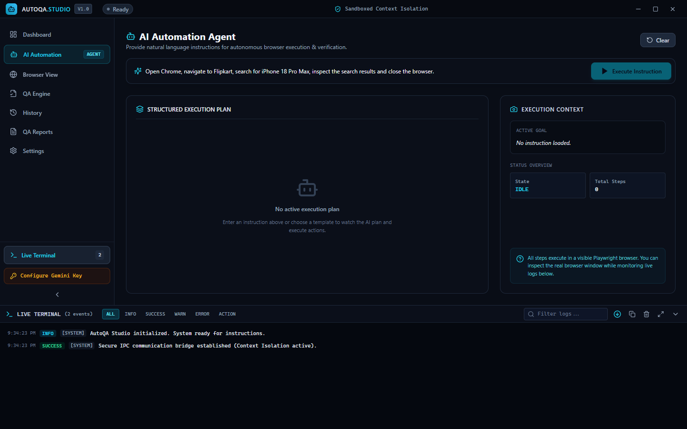
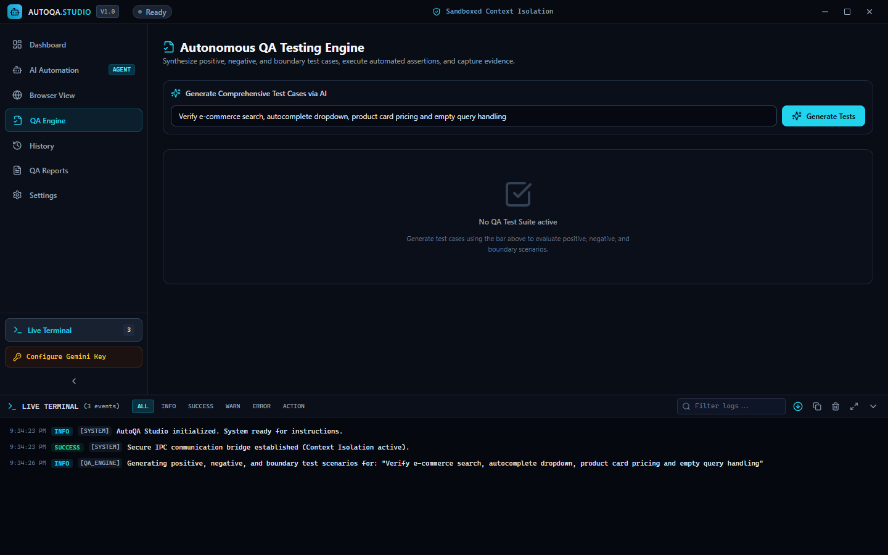
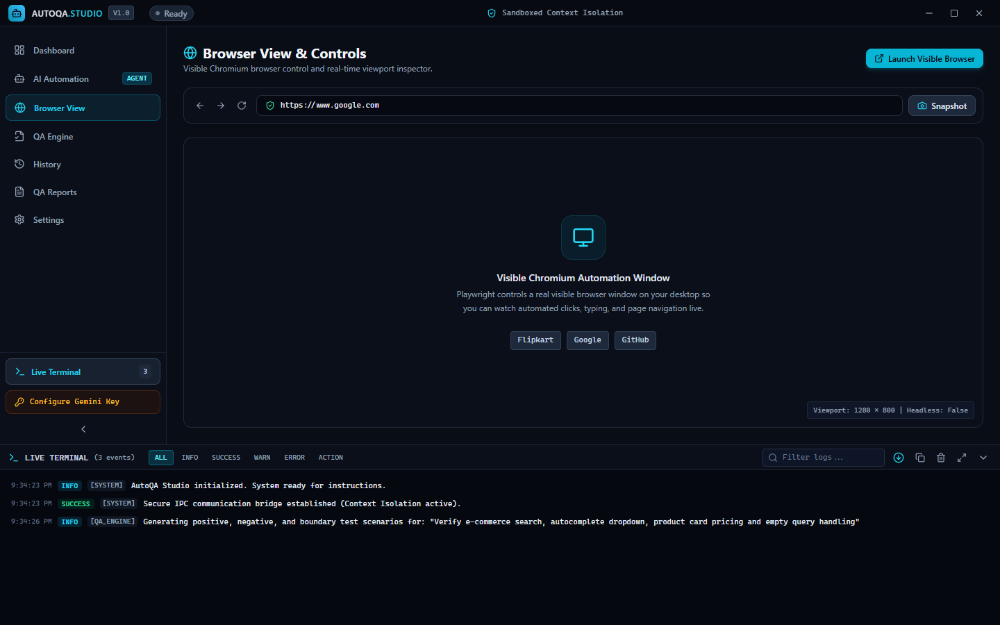
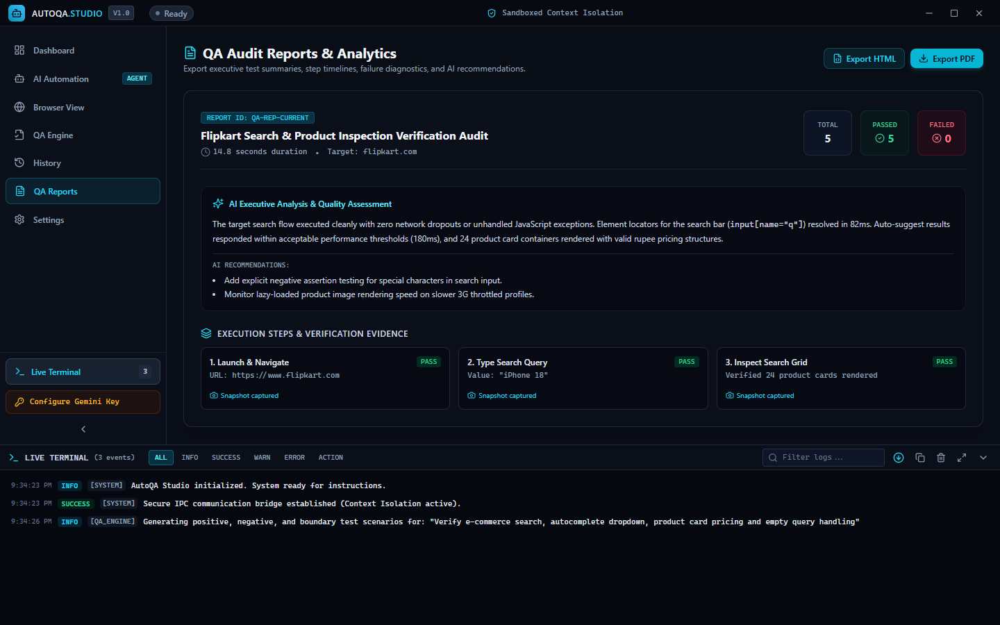
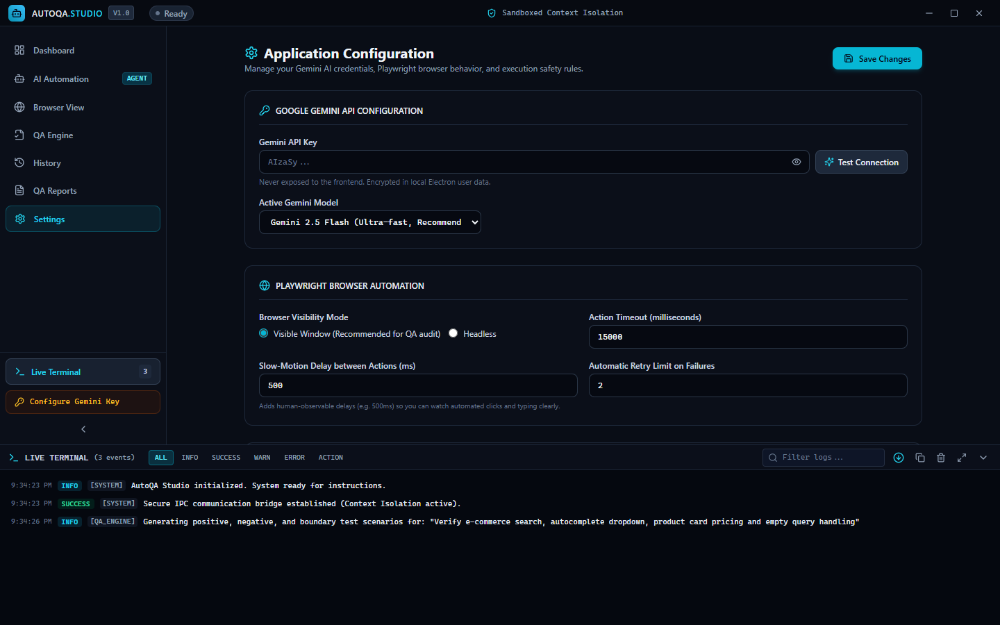
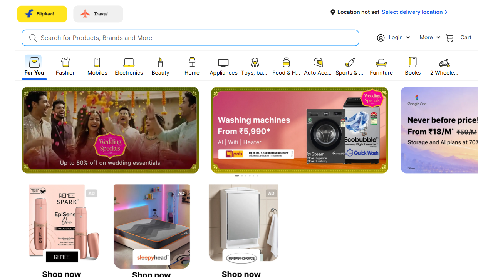
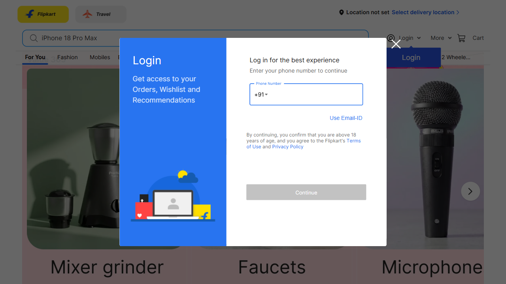
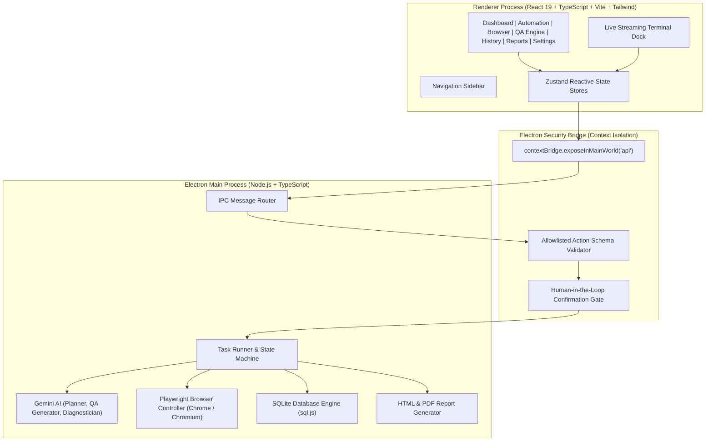

# 🤖 AutoQA Studio
### AI-Powered Autonomous Browser Automation & QA Testing Desktop Application for Windows

[](https://github.com)
[](https://electronjs.org)
[](https://react.dev)
[](https://www.typescriptlang.org)
[](https://playwright.dev)
[](https://ai.google.dev)
[](https://tailwindcss.com)
[](https://sqlite.org)
[](LICENSE)

---

## 🌟 Overview

**AutoQA Studio** is an enterprise-grade Windows desktop application that bridges natural language instructions with autonomous browser execution, self-healing Playwright automation, and autonomous QA test generation.

The application allows users to type natural language commands such as:
> *"Open Chrome, navigate to Flipkart, search for iPhone 18 Pro Max, inspect the search results and close the browser."*

AutoQA Studio parses the user's intent, creates a structured execution plan, launches a real visible Chromium/Chrome browser, executes every step sequentially, asserts page state, detects errors, self-heals selectors with AI, streams events in real-time, and saves visual test evidence to an embedded SQLite database.

---

## 🎥 Video Demonstration (Flipkart Automation & Search Test)

https://github.com/user-attachments/assets/demo-flipkart

> **Watch the autonomous test flow in action**:
> 1. Launching visible Google Chrome browser window.
> 2. Navigating to `https://www.flipkart.com`.
> 3. Handling popups and locating search bar input.
> 4. Typing `"iPhone 18 Pro Max"` with realistic human delay.
> 5. Pressing Enter and waiting for results to render.
> 6. Smoothly scrolling through product cards and verifying prices.
> 7. Capturing evidence screenshots and closing the session cleanly.

*Video file located in repository:* [`media/videos/flipkart_automation_demo.webm`](./media/videos/flipkart_automation_demo.webm)

---

## 📸 Application Screenshots

### 1. Central Control Dashboard

*High-level overview showing system readiness, recent test runs, QA pass rate, Gemini API health, and quick-launch templates.*

---

### 2. AI Automation Agent & Structured Plan Tree

*Natural language instruction bar with step decomposition, execution controls (Start, Pause, Resume, Stop, Retry), and real-time step status indicators.*

---

### 3. Autonomous QA Testing Engine

*Automated synthesis of Positive, Negative, Boundary, and Security test cases from user instructions with preconditions, steps, assertions, and status badges.*

---

### 4. Browser Viewport Inspector & Controls

*Visible Chromium browser control center with URL address bar, navigation controls, and snapshot preview.*

---

### 5. Executive QA Audit Reports & Analytics

*Comprehensive QA audit report dashboard with metrics matrices, AI quality assessment, and one-click HTML/PDF export.*

---

### 6. Application Configuration & Security Guardrails

*Secure Gemini API key input with connection tester, Playwright viewport & slowMo configurations, and human-in-the-loop authorization toggles.*

---

### 7. Flipkart Search Automation Evidence
| Homepage Navigation | Product Search & Inspection |
| :---: | :---: |
|  |  |

---

## 🏗️ Architecture



---

## ⚡ Main Features

### 1. 🧠 AI Automation Agent
- **Natural Language Parsing**: Accepts conversational instructions and translates them into Playwright actions.
- **Decomposition**: Decomposes high-level intent into sequential, atomic action steps.
- **Strict Allowlist**: All steps are validated against an allowlisted schema (`NAVIGATE`, `CLICK`, `TYPE`, `PRESS_KEY`, `SCROLL`, `HOVER`, `SELECT_OPTION`, `SCREENSHOT`, `WAIT_FOR_ELEMENT`, `ASSERT_TEXT`, `ASSERT_VISIBLE`, `READ_PAGE_CONTENT`, `CLOSE_BROWSER`).

### 2. 🌐 Visible Real Browser Automation
- **Playwright Core**: Native control of visible Google Chrome or Chromium.
- **Human Observable**: Configurable `slowMo` delay (e.g. 300–500ms) allows watching clicks, typing, and navigation live.
- **Resilient Locators**: Automatically attempts CSS, XPath, Text, Placeholder, and ARIA Role locators.
- **Telemetry Interception**: Captures console warnings/errors, unhandled JavaScript exceptions, and failed network calls.

### 3. 💻 Live Streaming Developer Terminal
- **Instant IPC Event Stream**: Sub-millisecond log pipe streaming events directly to the UI.
- **Color Coding**: Distinct styling for `INFO` (cyan), `SUCCESS` (emerald), `WARN` (amber), `ERROR` (rose), and `ACTION` (sky).
- **Interactive Controls**: Severity filtering, search, auto-scroll lock, copy to clipboard, and clear terminal.

### 4. 🧪 Autonomous QA Testing Module
- **Scenario Synthesis**: Generates Positive (happy path), Negative (error handling), and Boundary (edge cases) test cases.
- **Automated Assertions**: Verifies preconditions, executes steps, compares expected vs actual results, and marks `PASS`, `FAIL`, or `BLOCKED`.
- **Evidence Preservation**: Automatically captures screenshot evidence for each test scenario.

### 5. 🩹 Self-Healing Error Diagnostics
- **AI Failure Analysis**: Differentiates between transient selector changes and genuine application bugs.
- **Locator Healing**: Suggests alternative selectors based on live DOM snapshots.
- **Automatic Retries**: Safe backoff and retry mechanism within user-configured limits.

### 6. 📊 Reports & Offline SQLite Persistence
- **Offline Database**: Stores runs, test suites, test cases, and log history in local SQLite (`autoqa.sqlite`).
- **Interactive HTML**: Exports self-contained, standalone HTML reports with embedded CSS and base64 screenshots.
- **PDF Export**: Generates publication-ready PDF documents using Playwright headless printing.

### 7. 🛡️ Security Guardrails
- **Restricted Preload**: Strict context isolation; no raw Node.js or `child_process` exposure in renderer.
- **API Key Security**: Credentials stored safely in Electron `userData`, never exposed to renderer window.
- **Human-in-the-Loop Safeguard**: Sensitive actions (payments, purchases, checkout, account deletion) require explicit user approval via a confirmation modal.

---

## 🚀 Quick Start Guide

### Option A: Run the Pre-Built Windows Executable
Download the standalone executable directly from the repository release:
- **Installer**: [`release/AutoQA Studio-Setup-1.0.0.exe`](./release/AutoQA%20Studio-Setup-1.0.0.exe)
- **Portable App**: [`release/win-unpacked/AutoQA Studio.exe`](./release/win-unpacked/AutoQA%20Studio.exe)

*No development tools or Node.js required!*

---

### Option B: Build & Run from Source

#### Prerequisites
- **Node.js**: v18.0.0+ (v20+ recommended)
- **NPM**: v9.0.0+
- **Google Chrome** or **Microsoft Edge** installed on Windows

#### 1. Clone the Repository
```bash
git clone https://github.com/shrik4/autoqa-studio.git
cd autoqa-studio
```

#### 2. Install Dependencies
```bash
npm install
```

#### 3. Run in Development Mode (Vite HMR + Electron)
```bash
npm run dev
```

#### 4. Build Production Bundle
```bash
npm run build
```

#### 5. Package Standalone Windows Executable
```bash
npm run package:dir    # Packages standalone folder into release/win-unpacked
npm run package        # Packages single-file NSIS Windows installer
```

---

## ⚙️ Configuration

1. Launch **AutoQA Studio**.
2. Navigate to the **Settings** tab in the sidebar.
3. (Optional) Enter your **Google Gemini API Key** and click **Test Connection**.
   *(Note: AutoQA Studio includes an intelligent rule-based step generator that works offline even without an API key!)*
4. Select your preferred Gemini Model (`Gemini 2.5 Flash` or `Gemini 1.5 Pro`).
5. Configure browser viewport, visibility mode, action timeout, and slow-motion delay.
6. Click **Save Changes**.

---

## 📁 Repository Structure

```text
├── release/                           # Packaged Windows Executable & Installer
│   ├── AutoQA Studio-Setup-1.0.0.exe  # Standalone NSIS Windows Installer
│   └── win-unpacked/
│       └── AutoQA Studio.exe          # Portable Windows Executable
├── media/                             # Test Evidence, Screenshots & Videos
│   ├── videos/
│   │   └── flipkart_automation_demo.webm  # Real browser test recording
│   └── screenshots/
│       ├── app_dashboard.png
│       ├── app_ai_automation.png
│       ├── app_qa_engine.png
│       ├── app_browser_view.png
│       ├── app_qa_reports.png
│       ├── app_settings.png
│       ├── flipkart_homepage.png
│       └── flipkart_search_results.png
├── src/
│   ├── common/                        # Shared DTOs, Action Schemas, IPC Contracts
│   ├── main/                          # Electron Backend (Playwright, Gemini, SQLite, Reports)
│   ├── preload/                       # Secure Isolated Preload Bridge
│   └── renderer/                      # React 19 Frontend (Tailwind CSS, Stores, Views)
├── electron-builder.json5             # Packaging configuration
├── package.json
├── tailwind.config.js
├── tsconfig.json
└── vite.config.ts
```

---

## 📜 License

This project is licensed under the [MIT License](LICENSE).

---

<p align="center">
  <b>Built with ❤️ by the AutoQA Studio Team</b><br>
  <i>Empowering Autonomous Software Quality Engineering</i>
</p>
